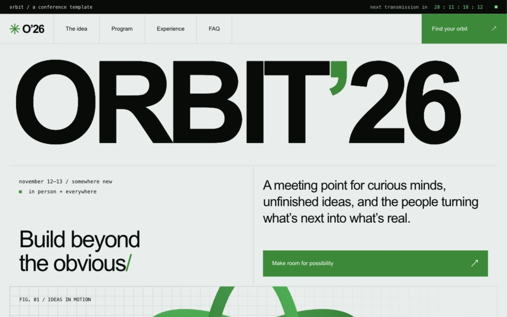

# Page Gems

**Interfaces worth keeping.** A personal collection of reusable web templates, built with care and designed to be adapted.

**English** · [简体中文](README.zh-CN.md)



## Templates

| Template | What it includes | Stack |
| --- | --- | --- |
| [Orbit conference](templates/orbit-conference/) | Event homepage, oversized typography, orbital artwork, two-day agenda, pass selector, FAQ | HTML, CSS, JavaScript |

## Preview

Open `index.html` directly in a modern browser, or serve the repository locally:

```sh
python3 -m http.server 8080
```

Visit [localhost:8080](http://localhost:8080). There is no install or build step, no external font request, and no runtime dependency. Internet access is not needed for the template.

## Make Orbit yours

1. Copy `templates/orbit-conference/` into your project.
2. Edit `index.html` for the event name, program, dates, prices, and FAQ. Replace the footer's collection link if you move the template.
3. Edit the `:root` variables in `styles.css` for colors. Layout and typography use system fonts.
4. Set `eventStartsAt` in `script.js`, including an explicit time-zone offset. An elapsed date displays zero; an invalid date shows “date to be announced.” Update the visible dates separately.
5. Replace the `.register` click behavior with your registration integration when you are ready. The included dialog is **only a demo**: it collects no personal data and processes no bookings or payments.
6. Verify your content at mobile and desktop widths and with keyboard navigation before publishing.

Agenda and attendance tabs support arrow keys, Home, and End. The mobile menu closes with Escape or a selected link. FAQ items use native `details`, registration uses native `dialog`, and reduced-motion preferences disable smooth scrolling and transitions. Countdown updates are deliberately not an ARIA live region.

## Structure

```text
index.html                       Collection homepage
README.md / README.zh-CN.md       English / Chinese documentation
templates/
  orbit-conference/
    index.html                   Event content and original inline SVG
    styles.css                   Responsive design and theme variables
    script.js                    Countdown, navigation, tabs, demo dialog
    template.json                Template metadata
    INSPIRATION.md               Reference and implementation boundaries
```

## Design reference

Orbit takes visual cues from the [GitHub Universe homepage](https://githubuniverse.com/): oversized black type, a pale gray-green canvas, a green accent, fine grid lines, and compact event information. It is an **original implementation**, not extracted source. The Orbit identity, copy, program, and geometric SVG are demo material made for this template; GitHub logos, photos, and site copy are not included. Page Gems is not affiliated with or endorsed by GitHub.

This collection is being prepared privately. An open-source license has not been selected yet; public reuse terms will be decided before an open-source release.
